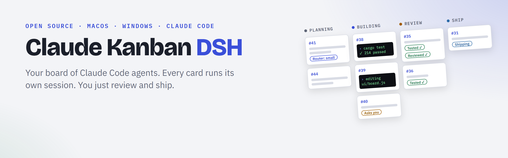
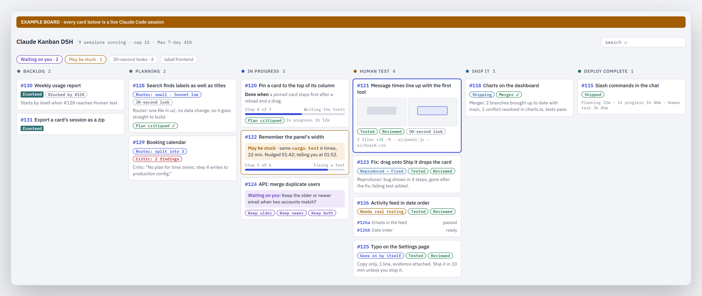
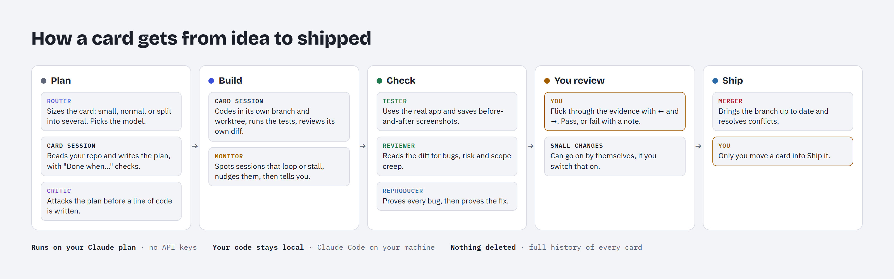
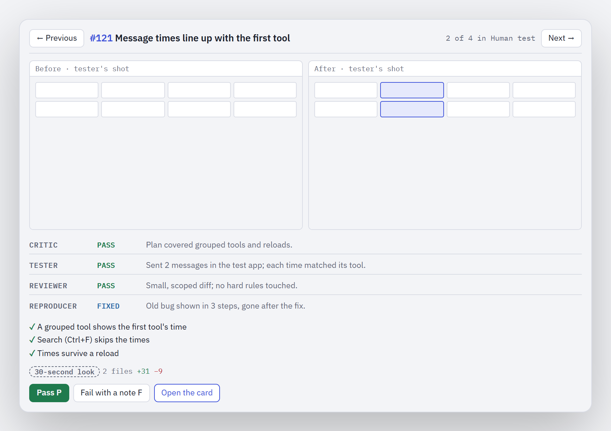

<p align="center">
  <picture>
    <source media="(prefers-color-scheme: dark)" srcset="docs/images/banner-dark.png">
    
  </picture>
</p>

<h3 align="center">Drag a card. Claude builds it. You ship it.</h3>

<p align="center">
  A desktop kanban board where every card is a live Claude Code session.<br>
  A team of agents plans, builds, tests and reviews each card before it reaches you.<br>
  <b>Runs on your own Claude subscription. No API keys. Your code stays on your machine.</b>
</p>

<p align="center">
  <a href="LICENSE"></a>
  
  
  
</p>

<p align="center">
  <a href="#quick-start">Quick start</a> ·
  <a href="#how-it-works">How it works</a> ·
  <a href="#the-agents">The agents</a> ·
  <a href="docs/GUIDE.md">Full guide</a> ·
  <a href="https://github.com/hughht5/claude-kanban-dsh/discussions">Discussions</a>
</p>

<p align="center">
  <picture>
    <source media="(prefers-color-scheme: dark)" srcset="docs/images/board-dark.png">
    
  </picture>
</p>

## Why

Run more than three or four Claude Code sessions and you start to lose track. Which one is waiting for you? Which has been looping on the same failing test for twenty minutes? Which one is actually done, and does it work?

Claude Kanban DSH is built around one idea: **not more agents, fewer surprises.** Every card gets its own session. A router sizes it, a critic tears into the plan before any code is written, a tester and a reviewer check the work, and a monitor keeps everything moving. By the time a card reaches you, it has been tested, reviewed and proved, and it comes with screenshots and the steps to check it.

You stay in charge of the one decision that matters: what ships.

## What you get

- **Every card is a live session.** Each card owns a real Claude Code session in an embedded terminal, with a chat view beside it. Open a card to talk to it, watch it work or take over the terminal. In the chat your words sit on the right, Claude's on the left, and what the app sends by itself (a column prompt, a test-app turn, the Router's events) in the centre in its own colour.
- **Truly parallel.** Every card builds in its own git worktree and branch, so a dozen cards can work at once without stepping on each other.
- **Plans that survive a critic.** A critic agent checks every plan before a line of code is written. It fails a plan only for a real problem (a dropped deliverable, a plan that would come out wrong, anything unsafe); smaller points go to the build as notes. A small card gets one critique.
- **Tested and reviewed before you see it.** A tester uses the real app and saves before-and-after screenshots. A reviewer reads the diff for bugs, risk and scope creep. Nothing reaches you until both pass.
- **Bugs proved, fixes proved.** When something fails, a reproducer shows the bug in a few steps, then shows that it's gone after the fix. No more re-testing by hand.
- **Never stuck.** A monitor watches every session. If one loops or stalls, it gets a nudge, and if it's still stuck, you get a notification.
- **Review in seconds.** Step through every card waiting for you with ← and →. Press P then Enter to pass and ship, or F to fail it with a note. Small changes are labelled "30-second look", and docs-only changes can go on by themselves if you allow them.
- **Know everything at a glance.** Every card shows "Done when…" with its acceptance checks, step progress ("Step 4 of 7: writing the tests", and the whole to-do list in its chat), what changed, and the exact question it's waiting on you for.
- **Ship together, cleanly.** Group related cards into a stack. They build in parallel, a merger brings their branches together and resolves conflicts, and you test and ship them as one.
- **Order and history.** Mark a card "Blocked by #12" and it starts by itself when #12 is ready. Search every session that has ever run. See how long cards spend in each column, so you know where the waiting happens.
- **Your own column widths.** Drag the edge of a column to widen or narrow it; every column keeps its share as the window changes, and the widths stay after a restart. Press an edge twice to reset them.

## How it works

<p align="center">
  <picture>
    <source media="(prefers-color-scheme: dark)" srcset="docs/images/flow-dark.png">
    
  </picture>
</p>

1. **Add a card and drop it into Planning.** The router decides whether it's small, normal or worth splitting, and picks the model and effort. The card's session reads your repo and writes a plan with "Done when…" checks. The critic attacks the plan before anything is built.
2. **In progress.** The session builds on its own branch, runs your tests and reviews its own diff. The monitor keeps an eye on it. List a repo under Settings > Sessions > "Build each card in its own worktree" and the app gives each of its cards its own git worktree inside the checkout (`.claude\worktrees\card-<n>`, on the branch `card-<n>`), so several cards of that repo build at once.
3. **Checked.** The tester and the reviewer run side by side: the tester tries the change for real and captures before-and-after screenshots, while the reviewer reads the diff. A fix for either one's finding means both run again, and the app won't count a pass that started before the other's fail. The reproducer proves any bug and its fix.
4. **Human test.** The card lands in front of you with its evidence, its verdicts and the steps to check it, and its own test app (Test, Test 2, ...) so several cards can wait for you side by side. Pass it or fail it with a note. A fail sends it straight back to work.
5. **Ship it.** Only you move a card into Ship it, unless you've told a card to go on by itself. Every repo's ships go through its own **merge lane**: one long-lived session for that repo that brings each ship's branch up to date with main in its own worktree, one at a time, resolves the conflicts, and remembers the earlier merges when the next one conflicts. There is nothing to set up: the app finds the repo's checkout from the card's worktree. The card shows **Waiting for the lane**, then **Merging**, then **Merged**; Settings shows each lane's state with a Stop button. The lane never pushes: the card's session still does, after checking the lane's commit.
6. **Clear the board.** The Router puts cards whose work is live into a **Done pile**, and one **Archive all** click archives them. It never archives a card by itself.

Each column's instructions are plain Markdown files you can read and change.

## The agents

| Agent | What it does | When |
|---|---|---|
| **Router** | Sizes each card: small, normal or split into several. Picks the model and effort. Runs at low effort, so it's fast and cheap. With Settings > Sessions > "Size cards before their session starts" (on by default), the app sizes the card with one quick call just before its session starts, so the session starts on the right model and effort and is never restarted onto them; the card shows "Sizing…" meanwhile. A card is sized only then (or by Route again): with the setting off, or when that call fails, nothing sizes it, and its session runs on your defaults with no route and no restart (card #161). | A card enters Planning |
| **Critic** | Fails the plan only for a real problem: a dropped deliverable, a wrong assumption the build wouldn't catch, a broken rule. Smaller points become build notes. | Before building |
| **Tester** | Uses the real app, follows the card's checks and saves before-and-after screenshots. | After building |
| **Reviewer** | Reads the diff for mistakes, risky changes and work nobody asked for. | After building |
| **Reproducer** | Proves a reported bug, then proves the fix. | Any failure |
| **Monitor** | Spots sessions that loop, stall or wait on each other. Nudges first, then tells you. | All the time |
| **Merger** | Brings branches up to date with main and resolves conflicts: one merge lane per repo, which keeps what it learnt across ships. A stack's lead also merges each finished child into the stack's branch with the card-merger subagent. | At ship time |

Every agent is a Claude Code subagent running on your own plan, and the app records each one's verdict on the card. None of them can move a card into Ship it.

Each card has its own choice of which of the six card agents run on it (all but the Monitor). Settings > Sessions sets the defaults for a new card; tick or untick them on Add card or in a card's details. Only you change them: a card's session and the Router can't. An agent that is off holds nothing, and the card's session is told to skip its step.

<p align="center">
  <picture>
    <source media="(prefers-color-scheme: dark)" srcset="docs/images/panel-dark.png">
    
  </picture>
</p>

## Quick start

**You need:** [Claude Code](https://docs.anthropic.com/en/docs/claude-code) signed in to your Claude account, plus [Rust](https://rustup.rs), Node.js and Git.

**macOS** (Apple silicon or Intel, with the Xcode command-line tools). **Untested:** the macOS build passes CI but hasn't been tried on a real Mac yet, and the app isn't signed with an Apple Developer ID, so macOS will ask you to allow it in **System Settings › Privacy & Security** the first time. Please [open an issue](https://github.com/hughht5/claude-kanban-dsh/issues) with anything you hit.

```bash
git clone https://github.com/hughht5/claude-kanban-dsh
cd claude-kanban-dsh && ./scripts/install.sh
```

**Windows 10 or 11** (with Visual Studio Build Tools 2022, "Desktop development with C++"):

```powershell
git clone https://github.com/hughht5/claude-kanban-dsh
cd claude-kanban-dsh; powershell -ExecutionPolicy Bypass -File scripts\install.ps1
```

Both install for your user only, with no admin rights. Then:

1. Open **Claude Kanban DSH** from Applications or the Start menu.
2. In **Settings › Sessions**, set a **Private folder**, then add your repos under **Repos a card can be for** (saved as that folder's `repos.json`, beside your own column prompts).
3. Click **Add card**, describe the work, pick a repo and drop it into **Planning**.
4. Watch it go. Answer its questions when it asks. Review it when it lands in **Human test**.

Want to try changes to the app itself without touching your real board? Add `--channel test` (macOS) or `-Channel test` (Windows) and a separate test copy installs beside it, with its own data.

## Drive it from anywhere

`kb` is a command-line tool and an MCP server, so any Claude session (or script) can run the board:

```text
kb create --title "Fix the login redirect" --repo you/web-app --column Planning
kb list --column "Human test"
kb send 12 "Use the v2 endpoint instead"
kb move 12 "In progress"
```

Add `kb mcp` to Claude Code as an MCP server, and every session gets the `kanban_*` tools.

## Who it's for

**For you if** you run several Claude Code sessions at once and want them organised, checked and reviewable, and you'd rather spend your time reviewing finished work than babysitting terminals.

**Not for you (yet) if** you're on Linux, you use agents other than Claude Code, or you want a hosted service. It's a local desktop app for macOS and Windows, built deeply around Claude Code.

## Your data

- Everything stays on your machine: the board, logs and sessions live in your user folder.
- There's no telemetry and no account. The app talks only to Claude Code on your machine and, if your column prompts use them, `git` and `gh`.
- Nothing is ever deleted. Card history, logs and session events are append-only, and finished cards are archived.

## Contributing

Issues and pull requests are welcome. Before you open one, run `cargo test --workspace` and turn on the pre-commit check with `git config core.hooksPath scripts/hooks`. The [full guide](docs/GUIDE.md) explains every feature in detail.

## Credits

Built by [Hugh Halford-Thompson](https://github.com/hughht5), with Claude Code. The agent team takes its ideas from DeepSeek's [DeepSeek Harness](https://github.com/deepseek-ai/deepseek-harness) and the AI Labs "super agent" workflow for Claude Code.

Not affiliated with or endorsed by Anthropic or DeepSeek. Claude and Claude Code are trademarks of Anthropic.

## Licence

[MIT](LICENSE)
